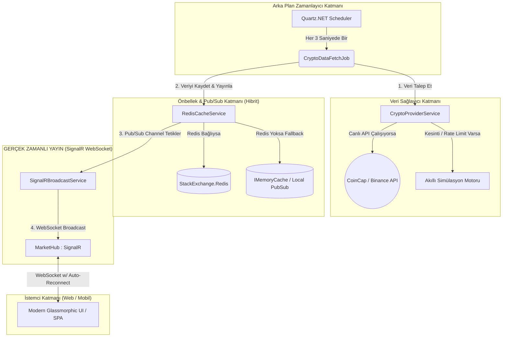

# ⚡ MarketPulse | Real-Time Notification & Background Processing Service


**MarketPulse**, arka planda periyodik olarak canlı piyasa/kripto fiyatlarını çeken, **Redis** üzerinde distributed caching ve Pub/Sub iletişimi sağlayan, **Quartz.NET** ile gelişmiş arka plan iş zamanlaması (job scheduling) sunan ve **SignalR WebSocket** kanalı üzerinden bağlı tüm web ve mobil istemcilere milisaniyeler içinde anlık (real-time) veri yayını yapan modern bir **.NET 9** servisidir.

---

## 🌟 Öne Çıkan Özellikler

* ⏱️ **Quartz.NET Arka Plan Zamanlayıcısı:** Her 3 saniyede bir (yapılandırılabilir) çalışarak dış API'lerden veya simülasyon motorundan veri toplayan güçlü, eşzamanlı çalışma korumalı (`[DisallowConcurrentExecution]`) arka plan işleri.
* 🚀 **SignalR WebSocket Canlı Akış:** Veri tabanını veya sunucuyu yormadan, sadece fiyatı değişen varlıkları anlık olarak istemcilere iten (server-push) çift yönlü iletişim.
* 🧠 **Akıllı Önbellek & Pub/Sub Hibrit Yapısı (Redis + In-Memory Fallback):**
  * Ortamda **Redis** aktifse: Distributed cache (`StringSetAsync` / `StringGetAsync`) ve mikroservisler arası ölçeklenebilir **Redis Pub/Sub** kanalları (`pulse:channel:tickers`, `pulse:channel:alerts`, `pulse:channel:status`) üzerinden çalışır.
  * Ortamda **Redis** yoksa / bağlantı koparsa: Uygulama **otomatik olarak In-Memory MemoryCache ve yerel (in-process) Pub/Sub** modeline geçer. *Bu sayede projeyi Git'ten klonlayan herhangi bir geliştirici, Redis kurmaya gerek kalmadan uygulamayı anında çalıştırabilir!*
* 🔄 **Akıllı API Kesinti Koruyucusu (Simulation Engine):** Harici borsa API'leri (CoinCap vb.) rate-limit veya ağ kesintisine uğradığında otomatik devreye giren yüksek frekanslı rasgele dalgalanma (Brownian motion / random walk) simülatörü.
* 🎨 **Premium Glassmorphism Web Dashboard (`wwwroot`):**
  * Koyu tema (Dark Mode), neon parlama efektleri ve Lucide ikonları ile donatılmış modern arayüz.
  * **Chart.js** ile sayfa yenilenmeden canlı güncellenen interaktif kripto grafik takibi.
  * SignalR, Redis ve Quartz sunucu durumlarını anlık gösteren canlı telemetri rozetleri.
  * UI üzerinden arka plan işini anlık tetikleyebilen (**Force Fetch Now**) veya test alarmları üretebilen kontrol paneli.

---

## 🏗️ Sistem Mimarisi ve Veri Akışı



---

## 📁 Katmanlı Proje Dizini (Clean Architecture)

Proje, bağımlılıkların doğru yönetilmesi ve sürdürülebilirlik amacıyla 4 ana katmandan oluşur:

```text
RealTimeMarketPulse/
├── src/
│   ├── RealTimeMarketPulse.Domain/          # [Domain Layer] Varlık modelleri, arabirimler (Interfaces)
│   │   ├── Models/
│   │   │   ├── CryptoTicker.cs
│   │   │   ├── MarketAlert.cs
│   │   │   └── SystemStatus.cs
│   │   └── Interfaces/
│   │       ├── ICacheService.cs
│   │       └── ICryptoProviderService.cs
│   │
│   ├── RealTimeMarketPulse.Infrastructure/  # [Infrastructure Layer] Redis / Memory Cache, Harici API İstemcisi
│   │   └── Services/
│   │       ├── RedisCacheService.cs         # StackExchange.Redis + In-Memory Fallback
│   │       └── CryptoProviderService.cs     # CoinCap API + Simulation Engine
│   │
│   ├── RealTimeMarketPulse.Workers/         # [Workers Layer] Quartz.NET arka plan zamanlanmış işleri
│   │   ├── Jobs/
│   │   │   └── CryptoDataFetchJob.cs
│   │   └── Extensions/
│   │       └── QuartzExtensions.cs
│   │
│   └── RealTimeMarketPulse.API/             # [Presentation Layer] ASP.NET Core Web API, SignalR Hub, UI
│   │   ├── Controllers/
│   │   │   └── MarketController.cs          # REST denetleyicileri (Manuel tetikleme ve durum)
│   │   ├── Hubs/
│   │   │   └── MarketHub.cs                 # SignalR WebSocket Hub
│   │   ├── Services/
│   │   │   └── SignalRBroadcastHostedService.cs
│   │   ├── wwwroot/                         # Tek Sayfalık Web Dashboard (SPA)
│   │   │   ├── index.html
│   │   │   ├── css/styles.css
│   │   │   └── js/app.js
│   │   ├── appsettings.json
│   │   └── Program.cs                       # DI Container, Middleware, CORS ayarları
│   │
├── docker-compose.yml                       # Redis ve Uygulama için tek tıkla kurulum
├── Dockerfile                               # .NET 9 Çok Aşamalı (Multi-Stage) Docker Görseli
└── RealTimeMarketPulse.sln
```

---

## 🚀 Kurulum ve Çalıştırma

### Seçenek 1: Yerel Geliştirme (.NET 9 SDK ile)

Sisteminizde **.NET 9 SDK** yüklüyse (Redis kurulu olmasa dahi akıllı fallback mekanizmasıyla) tek komutla çalıştırabilirsiniz:

```bash
# Projeyi derleyin
dotnet build RealTimeMarketPulse.sln

# API ve Dashboard sunucusunu başlatın
dotnet run --project src/RealTimeMarketPulse.API/RealTimeMarketPulse.API.csproj --urls "http://localhost:5000"
```
Tarayıcınızda **`http://localhost:5000`** adresini açarak canlı arayüzü deneyimleyebilirsiniz!

### Seçenek 2: Docker Compose ile Tek Tıkla Çalıştırma (Önerilen)

Redis ve uygulamanın izole bir ağda (Docker container içinde) tam kapasite çalışması için:

```bash
docker-compose up -d --build
```
Uygulama **`http://localhost:5000`** üzerinde açılacak ve Redis container'ı (`pulse-redis`) ile otomatik iletişim kuracaktır.

---

## 📡 REST API Endpoint'leri

Arayüz dışında dış sistemlerin veya terminal komutlarının servisle haberleşmesi için REST endpoint'leri sunulmuştur:

| Metot | Endpoint | Açıklama |
| :--- | :--- | :--- |
| `GET` | `/api/market/tickers` | Önbellekteki son kripto para birimi fiyat listesini JSON olarak döner. |
| `GET` | `/api/market/status` | Sistem bağlantı durumunu (SignalR, Redis, Quartz döngü sayısı) döner. |
| `POST` | `/api/market/trigger` | Quartz arka plan işini 3 saniyelik süreyi beklemeden **anlık tetikler**. |
| `POST` | `/api/market/test-alert` | Test amaçlı simüle edilmiş ani fiyat artışı alarmı üretir ve SignalR ile yayar. |

---

## 💻 Git Repository'ye Gönderme (Push) Rehberi

Bu projeyi kendi GitHub hesabınıza push etmek için aşağıdaki adımları takip edebilirsiniz:

```bash
# Git deposunu başlatın
git init

# Tüm dosyaları takip listesine ekleyin
git add .

# İlk commit işlemini yapın
git commit -m "feat: initial commit - Real-Time MarketPulse (.NET 9, SignalR, Quartz, Redis)"

# GitHub uzak deponuzu ekleyin
git remote add origin https://github.com/<KULLANICI_ADINIZ>/RealTimeMarketPulse.git

# Ana dala push edin
git branch -M main
git push -u origin main
```

---

## 🛡️ Lisans

Bu proje kişisel gelişim, portföy sergileme ve gerçek zamanlı (.NET 9 + SignalR + Quartz + Redis) mimarilerin referans alınması amacıyla serbestçe kullanılabilir ve geliştirilebilir.
